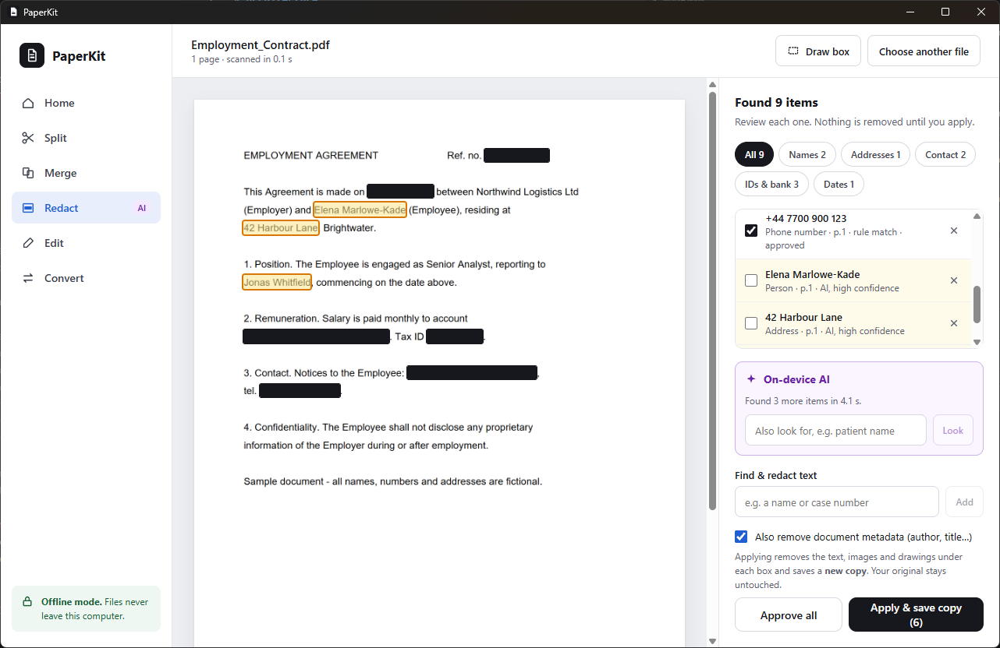

# PaperKit

Offline desktop PDF toolkit for Windows, macOS and Linux.
Drag & drop a PDF, then **Split · Merge · Redact (on-device AI) · Edit · Convert**.
Nothing is uploaded — all processing, including the AI, runs on the user's computer.



**[Download](https://github.com/oulismi/Paperkit/releases/latest)** · Windows 10/11 · macOS (Apple Silicon) · Linux

## Project layout

```
paperkit/
├── app/                     Desktop app (Tauri 2)
│   ├── src/                 Frontend — React + TypeScript
│   │   ├── app/             App shell, routing, layout, sidebar
│   │   ├── components/      Shared UI (buttons, drop zone, page thumbnails…)
│   │   ├── features/        One folder per tool
│   │   │   ├── home/        Drag & drop start screen, recent files
│   │   │   ├── split-merge/ Page organizer: split, merge, extract, reorder
│   │   │   ├── redact/      Redaction review UI (AI suggestions, approve/reject)
│   │   │   ├── edit/        Annotations, text/images, forms, page rotate/delete
│   │   │   └── convert/     PDF ↔ Word / images / text / PDF/A
│   │   ├── lib/             Typed wrappers around Tauri commands, pdf.js helpers
│   │   └── styles/          Design tokens, global CSS
│   ├── public/              Static assets
│   └── src-tauri/           Rust side of the app
│       ├── src/commands/    Tauri commands the UI calls (split, merge, redact…)
│       ├── capabilities/    Tauri permission files
│       └── icons/           App icons for all platforms
├── crates/                  Reusable Rust libraries (no UI code)
│   ├── pdf-core/            PDF operations: split, merge, redact, render, convert
│   └── redact-ai/           Sensitive-data detection
│       └── src/rules/       Regex/checksum rules (email, phone, IBAN, cards, IDs)
├── models/                  ONNX models (NER, OCR) — downloaded, not committed
├── scripts/                 Dev/build helpers (model download, packaging)
├── docs/                    Architecture, roadmap, decisions
├── tests/
│   ├── fixtures/            Sample PDFs (fake data only!)
│   └── e2e/                 End-to-end UI tests
└── .github/workflows/       CI: build + test on Windows, macOS, Linux
```

## Status

Working now:
- Drag & drop or browse PDFs, page thumbnails, reorder by dragging, rotate, remove
- **Split** (every N pages, custom ranges, at selected pages), **Merge**, **Extract**
- **Redact**:
  - format rules with checksums (English, French, Dutch, Greek): emails, phones, IBANs, cards,
    national IDs (FR NIR, GR ΑΜΚΑ), labelled IDs (BSN, ΑΦΜ, tax/VAT/passport/case numbers…), dates
  - on-device AI (GLiNER multilingual) for names, addresses and anything described in words
    ("patient name"); ~596 MB, downloaded once, then fully offline. Offered on first launch
    (Download now / Later / No thanks), by the Windows installer (yes/no question), and on the
    Redact screen; bundled in the offline installers
  - scanned pages are read with OCR (Tesseract in MuPDF; English, French, Dutch, Greek data
    bundled, ~13 MB), so detection and verification work on scans too
  - find-and-redact text, draw boxes, review and approve; saves a new copy with the content
    really removed (MuPDF), then verifies it

- **Convert**: PDF → Word (DOCX), PNG/JPG images, plain text, searchable PDF (OCR text layer
  for scanned pages); images (JPG, PNG, TIFF, BMP, GIF) → PDF
- **Edit**: add text (any of the four languages, embedded Noto Sans), images and signatures,
  whiteout boxes, highlights; fill form fields (text, checkbox, choice)

- **Drop bubble**: a small glass orb that stays on top of other windows; drag it anywhere (it
  remembers the spot). Drag a file near it and a ring of four actions opens: release on ↑ Redact,
  ← Split, → To Word, ↓ Edit, or the centre for the full list. Images get "Create PDF".
- **Tray icon**: open PaperKit, show/hide the bubble, start with the system (off by default), check
  for updates, quit.
- **Automatic updates**: checks GitHub releases, asks, installs signed updates and restarts
  Closing the main window keeps PaperKit running in the tray.

## Prerequisites

- Node.js 20+
- Rust (stable) via https://rustup.rs
- LLVM (libclang, clang-cl) to build MuPDF — Windows: `winget install LLVM.LLVM`
  (see `.cargo/config.toml`); the first build compiles MuPDF and takes a few minutes
- Windows: Visual Studio **2022** Build Tools, C++ workload (ONNX Runtime needs its C++ library)
- Tauri OS dependencies: https://tauri.app/start/prerequisites/
  (Windows: WebView2 + "Desktop development with C++" build tools)

## Run it

```sh
cd app
npm install
npm run tauri dev        # opens the desktop app with hot reload
```

`npm run dev`/`build` fetch the bundled assets first (OCR language data, Noto Sans), each
pinned and checked by SHA-256 (`scripts/fetch-*.mjs`).

Sample PDFs with fictional content are in `tests/fixtures/` (including a scanned contract); regenerate them with
`cargo run -p pdf-core --example sample_pdfs -- tests/fixtures`.

## Test

```sh
cargo test -p pdf-core -p redact-ai   # PDF engine, redaction, detection rules

# AI model test (downloads ~596 MB into models/ once):
node scripts/fetch-model.mjs
PAPERKIT_MODEL_DIR=models/gliner_multi-v2.1 cargo test -p redact-ai --features ner --release -- --ignored
cd app && npm test       # split planning logic
npm run typecheck
```

## Installers

`cd app && npm run tauri build` (output under `target/release/bundle/`). Add
`--config src-tauri/tauri.offline.conf.json` (after `node scripts/fetch-model.mjs`) for the
offline variant with the AI model bundled.

GitHub Actions (`.github/workflows/`):
- `ci.yml`: tests on Linux and Windows for every push to `main` and every pull request
- `release.yml`: pushing a tag like `v0.1.0` builds Windows (NSIS + MSI), macOS (Apple Silicon DMG)
  and Linux (AppImage, deb, rpm) installers, standard and offline, into a **draft** release

Builds are not code-signed yet (Windows SmartScreen / macOS Gatekeeper will warn). Update signing,
macOS notarization and Windows signing switch on via GitHub secrets: see
[docs/SIGNING.md](docs/SIGNING.md).

## Home page

`site/` is the public home page (plain HTML, screenshots in `site/screens/`), published to GitHub
Pages by `.github/workflows/pages.yml` once the repository is public. Screenshots are captured from
the real app: `scripts/screenshots.ps1` (Windows) opens each screen in demo mode with the sample files.

See [docs/ARCHITECTURE.md](docs/ARCHITECTURE.md) for the technical plan.

## License

AGPL-3.0-or-later (see [LICENSE](LICENSE)), as required by MuPDF.
